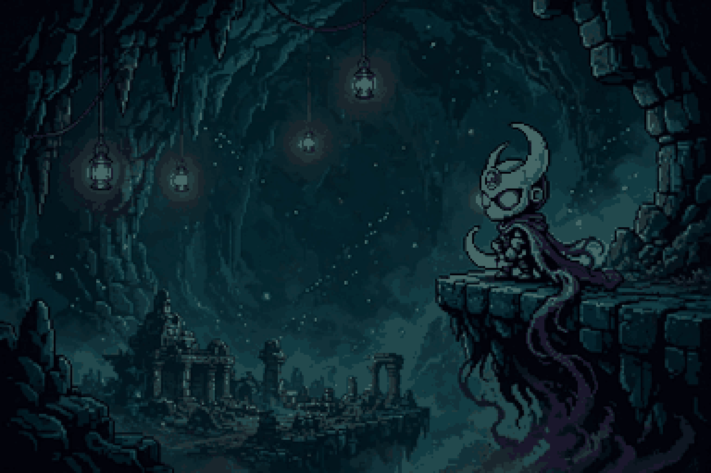
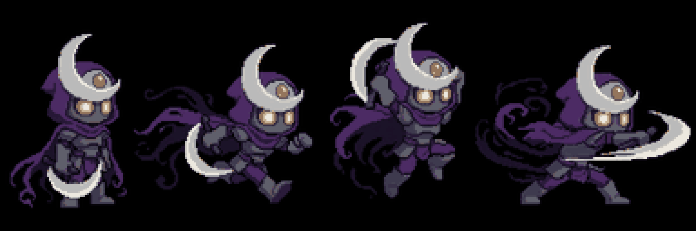
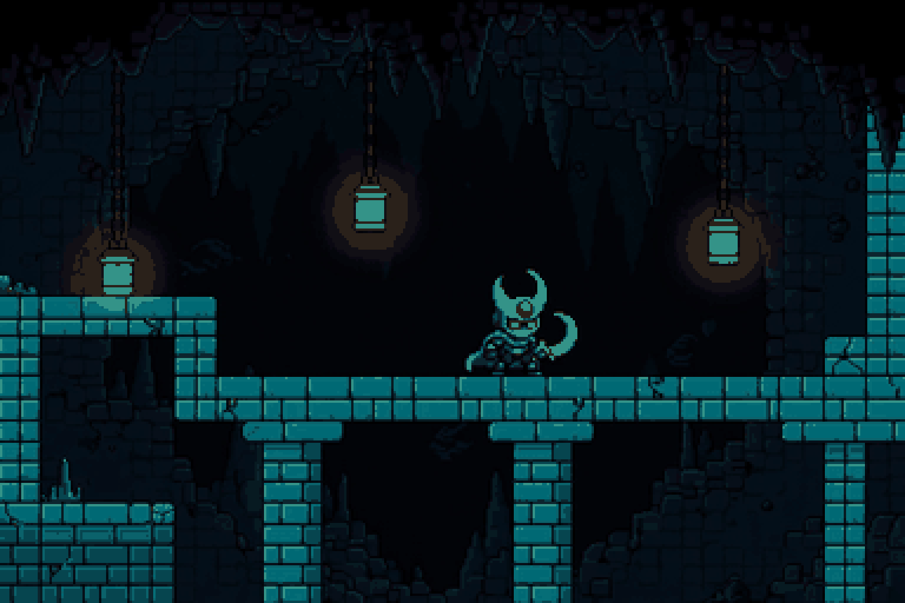
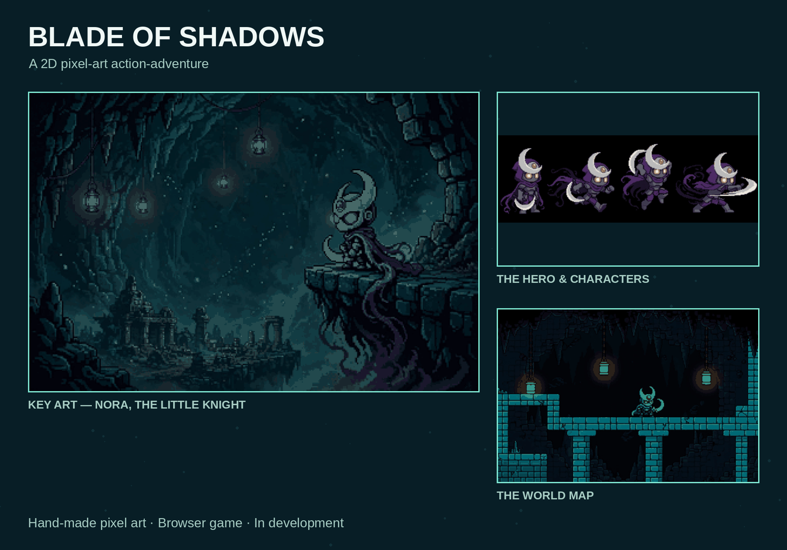

# Nasl Althilal — Blade of Shadows

A 2D action-adventure platformer that runs in the browser, with a fully Arabic interface.

The little knight **Nora** enters the caves of Oran in search of the three Light Shards. Collect them, face the guardians of darkness, and open the Gate of Return.

## The game

- Story-driven stages with a region map and a live minimap
- Choose your blade and your cloak before the adventure — every hero has their own effect
- Combat, dashing and a light-pulse ability
- Hand-made pixel art: hero, world map and regions drawn frame by frame
- Character preview chip at the top of the screen while you play

## Controls

| Action | Key |
|---|---|
| Move | A / D |
| Jump | Space |
| Attack | J |
| Dash | K |
| Light Pulse | L |

Touch controls are included for mobile, with landscape support.

## Play it

Open `index.html` in a browser — the whole game is a single HTML file (HTML, CSS and JavaScript with canvas), plus the title artwork `hero-master.png`. No build step, no dependencies.

## Art

## Status

In active development by **Mohamed Srai** — new regions, enemies and bosses are being added stage by stage.
