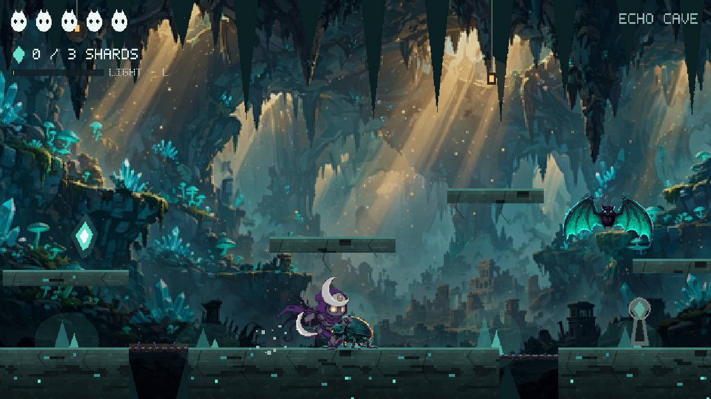

# Blade of Shadows

A 2D pixel-art action-adventure, built natively in C++17 with SDL2.

Deep beneath the city of Oran, the lighthouse has gone dark. The little
knight Nora wakes in the Echo Cave with a crescent blade in hand, while
the cave guardians scatter the stolen Light Shards through the deep.
Recover all three shards in each region, open the sealed gate, and climb
toward the one who darkened the light.

Every hero frame is real, hand-placed pixel art: a crescent-moon mask, an
amber gem, glowing amber eyes, and a deep violet cloak that ends in tails
of living shadow.



## Status: Milestone 1

Playable today:

- **Stage 1 — Echo Cave**, ported faithfully from the design of the web
  prototype: 13 platforms, arming spike traps, a checkpoint altar, and
  the exit gate that opens once all 3 Light Shards are found. The cave
  wears its painted look here too: the hand-painted panorama backdrop,
  parallax-scrolled with a readability scrim over it, and rock-textured
  platforms that keep the mint lit top edge.
- **Full hero moveset**: run, jump and double jump, coyote time, jump
  buffering, variable jump height, and a dash with invulnerability
  frames and a ghost trail. Landing refreshes the dash.
- **Combat**: the Blade of Shadows melee strike, knockback and
  invulnerability frames on hurt, and the Light Pulse — a charged area
  blast (charged by landing hits) that spends a full Light meter.
- **Enemies**: the Crawler (ground patrol), the Bat (sine-wave flight
  that tracks the player), and the Sonic (patrol) — all drawn with the
  approved v3 pixel-art sprites at presence scale, with ground shadows
  and a soft stage-accent halo (see "Enemy presence" below). The spike
  traps use the matching v3 art as well.
- **Screens and HUD**: title screen, stage intro, pause, death and
  stage-complete screens; health masks, shard counter and Light meter.
- **Headless QA mode**: the game can render itself with scripted inputs
  and save a PNG screenshot, with no display attached (see below).

## Enemy presence

Rich painted backgrounds can swallow small sprites, so Blade of Shadows
gives its enemies a presence treatment: a larger draw size than their
hitboxes (40 percent larger for most enemies, 70 percent for the
smallest ones — the Crawler and the Bat), a soft shadow that grounds
each enemy to the floor, and a subtle rim glow in the stage's accent
colour. The goal is simple — enemies that read instantly as threats,
without touching the stage art, the terrain, or how anything plays.

The treatment is applied in this build to the Stage 1 roster, and in the
web build across all three regions. Comparison captures live in
`media/`: `echo-cave-presence.jpg`, `crystal-vault-presence.jpg` and
`ash-castle-presence.jpg` show each region's enemies with the treatment
applied, `size-relationship.jpg` sets the hero beside the Crawler and
the Ash Lord at both scales, and `blade-integrated-cave.png`,
`blade-integrated-vault.png` and `blade-integrated-castle.png` are
captures of the integrated result. The same folder holds the design
sheets and the key art.

## Controls

| Action              | Keys          |
| ------------------- | ------------- |
| Move                | A / D or Left / Right arrows |
| Jump / double jump  | Space         |
| Attack              | J             |
| Dash                | K             |
| Light Pulse         | L (needs a full Light meter) |
| Pause               | Esc           |
| Confirm             | Enter         |

## Build

Debian / Ubuntu:

```sh
sudo apt install libsdl2-dev libsdl2-image-dev
make
./blade
```

The window is 1280x720; the game world renders internally at 960x540
(the prototype's canvas size) and upscales with nearest-neighbour
filtering, so the pixel art stays chunky.

## Headless screenshots

```sh
./blade --screenshot out.png          # scripted gameplay run
./blade --screenshot out.png 200      # same, with a custom frame count
./blade --screenshot out.png title    # title screen
./blade --screenshot out.png attack   # attack pose at the first Crawler
```

Screenshot mode uses SDL's dummy video driver and the software renderer,
plays a fixed input script (the dash-and-double-jump route across the
first spike gap), and writes a PNG — no display required.

## Roadmap

- Stage 2 — Crystal Vault, and Stage 3 — Ash Castle with the Ash Lord
  boss fight.
- Weapon unlocks: Moon Spear, Seal of Light, Echo Axe, Crystal Chain.
- The Lumi and Ember outfits, with their traits.
- Remaining enemy types (Sentinel, Dust, Turner, Crystal Warden) and
  the Sonic's sound-wave attack.
- Wall slide and wall jump.
- Sound effects and ambience.
- Minimap and quest atlas.

## Tech

C++17 · SDL2 · SDL2_image. Single-file game source (`src/main.cpp`), no
engine, no frameworks — just a window, a renderer, and hand-drawn
pixels.
